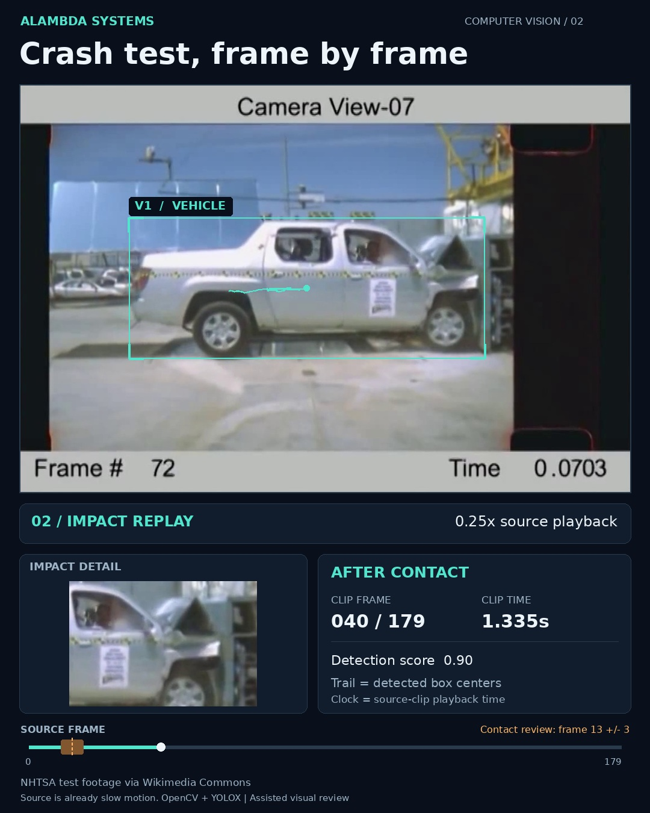

# Alambda Crash-Test Vision

An assisted OpenCV (`cv2`) prototype that adds a vehicle box, a temporary tracking ID, and an image-space movement trail to a controlled crash-test recording.

[Watch the demo](docs/demo.mp4) · [Download the MP4](docs/demo.mp4?raw=true) · [Download the code ZIP](docs/code.zip?raw=true) · [Join the free ArchTek AI community](https://www.skool.com/archtek-ai-6649/about)

[](docs/demo.mp4)

The sample is a short excerpt of [NHTSA's test of the 2006 Honda Ridgeline](https://commons.wikimedia.org/wiki/File:NHTSA_Crash_Test_of_the_2006_Honda_Ridgeline.ogv): source playback seconds **50–56**, extracted as **180 frames at 30000/1001 FPS** (6.006 seconds). Its source is already slow motion. Playback multipliers and timestamps in this demo refer to the **source video**, not physical time during the crash.

## Run the included example

Use **Python 3.12** and install **FFmpeg** with the `ffmpeg` and `ffprobe` commands available, including H.264 encoding through `libx264`. From this project's directory:

```bash
python -m pip install -r requirements.txt
python render_demo.py
```

This repository and the [standalone code bundle](docs/code.zip?raw=true) include `assets/source.mp4` and the reviewed example's `output/tracks.json`, so rendering does not require a model download or model inference. The renderer produces `output/Alambda_Crash_Test_Slow_Motion.mp4`, a silent **1080 × 1350 H.264 video lasting about 18.6 seconds**, and `output/Alambda_Crash_Test_Preview.jpg`. It shows an overview at 1× source playback, then a critical replay at 0.25× source playback with a hold at the manually marked contact frame. [The render summary](output/render_summary.json) records the exact frame sequence. The finished video and preview are also available in [docs](docs/README.md).

To obtain missing inputs and rerun detection:

```bash
python download_assets.py
python process_crash.py
python render_demo.py
```

To restore only the sample footage, use `python download_assets.py --source-only`. The downloader verifies the included excerpt when present; otherwise, it downloads the checksum-verified original and extracts the segment recorded in `assets/source.json`. Model weights are retrieved separately from OpenCV Zoo and checked by SHA-256. A GPU and API key are not required.

The implementation was run with Python 3.12.14, OpenCV 5.0.0, NumPy 2.3.5, Pillow 13.0.0, and FFmpeg 7.1.5 (`7.1.5-0+deb13u1`). `requirements.txt` uses compatible version ranges rather than an exact environment lock. Different FFmpeg/encoder builds can produce different compressed bytes; the downloader rejects an excerpt checksum mismatch instead of silently substituting a different file. The included verified excerpt avoids that re-encoding dependency.

## What the code does

- **Detection:** OpenCV DNN runs the OpenCV Zoo YOLOX-S model. It accepts proposals whose highest-scoring COCO class is car, bus, or truck.
- **Association:** The largest eligible vehicle starts temporary ID `V1`. Subsequent detections are selected using box overlap and center proximity. `V1` is a local association for this clip, not a verified vehicle identity.
- **Overlay:** Boxes are actual detector outputs. The trail uses their centers in image pixels. Missing detections remain absent; no interpolated or continued boxes are presented as observations.
- **Presentation:** A manually reviewed contact marker at zero-based clip frame **13**, with an estimated uncertainty of **±3 frames**, guides the replay and hold. Contact is not detected automatically, and the marker is approximate.

[The processing summary](output/processing_summary.json) records one accepted truck-class detection in each of the **180 source frames** for this run. Coverage is a processing statistic, not a measurement of detection accuracy or identity correctness. [The tracking data](output/tracks.json) retains the accepted boxes, confidence scores, class labels, and source-relative timestamps.

## Reuse with another fixed-camera clip

Start with a short clip containing one main vehicle and no camera cuts. Supply footage you can use, then run:

```bash
python process_crash.py --source path/to/clip.mp4 --output output/custom/tracks.json --confidence 0.20 --min-area-ratio 0.05 --roi 0 0 1 1
```

`--roi` is a normalized `X1 Y1 X2 Y2` rectangle; `(0, 0)` is the top-left and `(1, 1)` the bottom-right of the image. Tighten it to exclude background vehicles. Adjust the confidence threshold and minimum box area to suit the new view, then review the resulting boxes and gaps.

Before rendering another clip, replace the sample's source metadata, contact annotation, and replay interval with values reviewed for that clip. Pass the matching video, tracks, and metadata with `--source`, `--tracks`, and `--provenance`. Set both `--display-crop X1 Y1 X2 Y2` and `--detail-crop X1 Y1 X2 Y2`: these use **source-image pixels**, and their defaults are hardcoded for the reviewed NHTSA view. For the main display, use the full frame or a crop within your video's dimensions; select a reviewed contact area for the detail crop. Default crops may exceed the bounds of another resolution. Consult `python render_demo.py --help` for the contact, replay, and output options. The supplied contact frame belongs only to the included NHTSA excerpt.

## Limits

Crushing changes the vehicle's appearance. Occlusion, smoke, debris, motion blur, unusual viewpoints, or multiple vehicles can cause missed boxes, poor localization, class changes, or incorrect associations. A box center is a visualization point, not a physical landmark or center of mass. A line between observed centers does not establish the trajectory between frames.

This is an **assisted experimental demonstration**, with no independent accuracy benchmark. It does not estimate calibrated speed, distance, acceleration, impact force, injury, fault, or causation, and it is not a forensic reconstruction.

## Build with us

**[Join the free ArchTek AI community](https://www.skool.com/archtek-ai-6649/about)** to learn, build, and share AI projects with Alambda Systems. This signup is for community membership. Share your experiments, ask questions, or suggest an improvement through a repository issue.

Explore the related **[Alambda Basketball Vision](https://github.com/Alambdasystem/alambda-basketball-vision)** project for player detections, reviewed identity associations, and an approximate court map.

## Files and credits

| File | Purpose |
| --- | --- |
| `download_assets.py` | Verify or download the source and model; recreate the selected excerpt |
| `process_crash.py` | Vehicle detection and single-vehicle association |
| `render_demo.py` | Annotated overview, replay, hold, and preview |
| `assets/source.json` | Exact source provenance, checksums, extraction, and manual annotation |
| `output/tracks.json` | Actual accepted detector observations |
| `output/processing_summary.json` | Processing counts and limitations |
| `output/render_summary.json` | Playback sequence and final video properties |
| `docs/demo.mp4` | Finished annotated demonstration |
| `docs/demo-preview.jpg` | Preview image |
| `docs/code.zip` | Standalone runnable example with source footage and tracks |

Code: **Alambda Systems**, distributed under [Apache License 2.0](LICENSE). Footage: **NHTSA**, hosted by Wikimedia Commons, which identifies it as a U.S. government public-domain work. Detection model and decoding example: **OpenCV Zoo / YOLOX**. See [THIRD_PARTY.md](THIRD_PARTY.md) for source links and licensing details.
